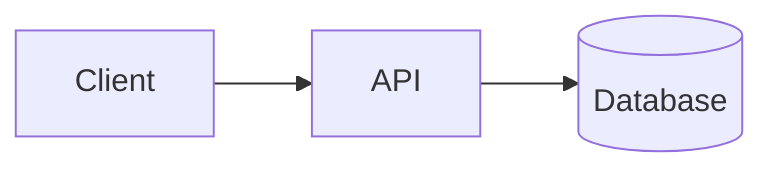

# md2star: Examples & Syntax Reference ⭐️

[🇫🇷 EXEMPLES.md](https://github.com/warith-harchaoui/md2star/blob/main/EXEMPLES.md) · 🇬🇧 English

Welcome to the `md2star` syntax reference! Because `md2star` extends pure Pandoc by fixing annoying layout issues (especially surrounding bullet lists and `mermaid` blocks), you can format documents dynamically without breaking workflows.

The snippets in sections 1 to 11 were run against **md2star 3.10.0 and Pandoc
3.6.1** on 2026-10-27, offline, and every output quoted below is what came
back. Section 12 is the exception — it needs a designer's template plus a local
LLM and VLM — and it says so where it starts, rather than dressing an
unmeasured run up as a transcript.

The sources behind the examples live in
[`tests/examples/`](https://github.com/warith-harchaoui/md2star/tree/main/tests/examples).
The rendered `.docx` / `.pptx` are **not** in the repository — they are build
output, and `.gitignore` keeps them out — so render them yourself:

```bash
cd tests/examples && ./run.sh      # DOCX + PPTX for every source below
```

| Source | What it demonstrates |
|---|---|
| `comprehensive_document.md` | the whole syntax surface in one document |
| `comprehensive_presentation.md` | the same as slides, including a `::: columns` split |
| `guide_complet_document_fr.md` | a French document: detected language, localized date |
| `branded_slides.md` + `Presentation1.pptx` | a custom `.pptx` used as a reference template |
| `footnotes_document.md` | footnotes, in DOCX and in PPTX |
| `table_zoo.md` | wide and skewed tables (not in `run.sh`: `md2docx table_zoo.md`) |

## Table of Contents

- [Setup](#setup)
- [1. Title and Subtitles](#1-title-and-subtitles)
- [2. Mermaid Diagrams](#2-mermaid-diagrams)
- [3. Flawless List Formatting](#3-flawless-list-formatting)
- [4. Multi-Column Slides (PPTX Only)](#4-multi-column-slides-pptx-only)
- [5. LaTeX Mathematics](#5-latex-mathematics)
- [6. Corporate Bibliographies](#6-corporate-bibliographies)
- [7. Branded Templates (PPTX)](#7-branded-templates-pptx)
- [8. Language Detection & Date Localization](#8-language-detection--date-localization)
- [9. Page Breaks (DOCX only)](#9-page-breaks-docx-only)
- [10. Footnotes](#10-footnotes)
- [11. Reverse direction: the Markdown twin](#11-reverse-direction-the-markdown-twin)
- [12. Template-Intelligent PPTX](#12-template-intelligent-pptx)
- [Command line](#command-line)
- [Troubleshooting](#troubleshooting)

## Setup

```bash
pipx install md2star        # the four CLIs + the GUI, in their own venv
brew install pandoc         # the one hard dependency (apt: pandoc, winget: JohnMacFarlane.Pandoc)
md2star doctor              # what is installed, what is missing, what still works
```

`md2star doctor` is the one command to run before anything else: it prints the
Python, md2star and Pandoc versions, then each optional dependency with the
reason you would want it. Three features need one more thing on the PATH — PDF
output needs LibreOffice (`soffice`), Mermaid needs Node.js, and the opt-in AI
passes (`--lint`, `twin --diagrams`, `--smart-layout`) need a local model
runtime. Two commands live behind extras: `pip install 'md2star[pptx]'` for
`md2star audit` and `md2pptx --smart-layout`, `pip install 'md2star[ocr]'` for
`md2star twin`.

Every shell snippet below assumes a Markdown file in the current directory and
nothing else. `--offline` appears wherever a run would otherwise be allowed to
fetch the default template from `deraison.ai`; drop it when you want that
template.

The Python snippets assume these imports:

```python
from pathlib import Path

from md2star import preprocess_markdown  # the Markdown-fixing pass, alone
from md2star.pipeline import ConvertOptions, convert  # the whole conversion, as one call
from md2star.pptx_audit import audit, summarise  # the deck checker ([pptx] extra)
```

`convert` is the public entry point: the CLI, the GUI server and the HTTP API
all reach the engine through it, with the same frozen `ConvertOptions`
dataclass. Every field has the same default the CLI advertises, so a short call
is a complete one:

```python
rc = convert(
    "docx",
    ConvertOptions(input="doc.md", output="api-out.docx", offline=True, author="Ada Lovelace"),
)
print("rc =", rc)
```

```text
Wrote: …/api-out.docx
rc = 0
```

A non-zero return is Pandoc's own exit code (or LibreOffice's, for `pdf`),
handed back rather than swallowed.

---

## 1. Title and Subtitles

`md2star` automatically extracts the first `# Heading` and uses it as the document **Title** metadata. If you use `--author`, the author string alongside the localized date constructs the **Subtitle**.

```bash
md2docx doc.md --author "Someone Great" --offline
```

Run on a one-paragraph English document titled `# Quarterly report`, that puts
exactly three strings at the top of the DOCX — title, author, date:

```text
['Quarterly report', 'Someone Great', 'Tuesday, October 27, 2026']
```

The date follows the **detected** language, and the Lua filter capitalizes its
first character on purpose, so a French or Russian weekday reads as a title
rather than as prose. The same one-paragraph document in four languages,
converted on 2026-10-27:

| Detected language | Subtitle date |
|---|---|
| English (`en-US`) | `Tuesday, October 27, 2026` |
| French (`fr-FR`) | `Mardi 27 octobre 2026` |
| Spanish (`es-ES`) | `Martes, 27 de octubre de 2026` |
| German (`de-DE`) | `Dienstag, 27. Oktober 2026` |

Pass `--date` to override the whole thing with a string used verbatim
(`--date '2026-Q2'`).

---

## 2. Mermaid Diagrams

Standard Pandoc breaks on ````mermaid` fenced code blocks. `md2star` automatically converts them to high-resolution PNGs using the Mermaid CLI locally; no data leaves your machine.

```markdown
Here is our pipeline architecture:

` ` `mermaid
graph LR;
    Raw[Markdown Source] --> Engine[md2star Preprocessor]
    Engine --> Office[DOCX/PPTX]
` ` `
```

Converted with `md2docx mer.md --offline`, that three-node graph takes about
three seconds end to end and arrives in the DOCX as a real image part:

```text
['word/media/rId20.png']
```

> [!TIP]
> Mermaid rendering requires Node.js (≥16) on your PATH. `md2star` calls
> `npx -y @mermaid-js/mermaid-cli`, so the CLI is fetched once on first use (the
> only network step) and a global `mmdc` is used when you have one. Rendering
> itself is local: the diagram source never leaves the machine.

---

## 3. Flawless List Formatting

Markdown writers often glue unordered lists directly to paragraphs, which breaks Pandoc output by forcing inline blocks. `md2star`'s Python AST engine automatically inserts the correct spacing so bullet lists always render cleanly.

```markdown
# Offer

Our company provides:
- Seamless DOCX wrapping
- Deep PPTX grid-structuring
- Mathematics evaluations
```

You can watch the fix happen without converting anything, because the
preprocessor is a plain function:

```python
print(preprocess_markdown(Path("list.md").read_text(), base_dir="."))
```

```text
---
lang: en-US
date_format: "%A, %B %e, %Y"
---

# Offer

Our company provides:

- Seamless DOCX wrapping

- Deep PPTX grid-structuring

- Mathematics evaluations
```

Two things happened: the blank line Pandoc needs before the list was inserted,
and the detected language was injected as front matter (see section 8). The
resulting DOCX carries three real list items — three `w:numPr` numbering
properties — instead of one run-together paragraph.

---

## 4. Multi-Column Slides (PPTX Only)

Split a slide into halves with Pandoc's **fenced-div** column syntax: a
`columns` div holding one `column` div per half.

```markdown
## Two halves

::: columns
:::: column
This is my left paragraph.
::::

:::: column
This is my right paragraph.
::::
:::
```

`md2pptx cols.md --offline` puts both halves on one slide, on Pandoc's own
`Two Content` layout, with the heading as its title:

```text
ppt/slides/slide3.xml  slideLayout4.xml (Two Content)
  ['Two halves', 'This is my left paragraph.', 'This is my right paragraph.']
```

Two measured details are worth keeping:

- The div has to be the slide's content, **directly** after the heading. A
  paragraph between the two pushes the columns onto a slide of their own —
  Pandoc starts a new slide at the div rather than mixing the two shapes.
- A bare `{.column}` line is **not** column syntax. Pandoc has no such span, so
  it travels through as literal text and PowerPoint shows you `{.column}` in the
  middle of the slide. `tests/examples/comprehensive_presentation.md` used to
  carry that form; it now carries the one above.

---

## 5. LaTeX Mathematics

Use native LaTeX expressions inside `$$` tags. Pandoc compiles them into Word / PowerPoint native Mathematical Equation objects.

```markdown
We evaluate the standard structural equation:

$$
e^{i \times \pi}+1 = 0
$$
```

The DOCX that comes back holds the equation as a native Word equation object
(an `m:oMath` node inside `m:oMathPara`) and contains **zero** `w:drawing`
elements: nothing was quietly rasterised into a picture, so the formula is
still editable in Word's equation editor.

---

## 6. Corporate Bibliographies

For large technical documents, `md2star` leverages native `.bib` libraries via `--bib`:

```markdown
Standard AI scaling laws have been deeply structured inside causality research metrics [@causality-pearl].
```

**Compilation:**
```bash
md2pptx presentation.md --bib references.bib --bibliography-name "References"
```

The `--bibliography-name` flag injects a heading at the end of the document,
before the compiled citation list. Omit it and md2star uses the localized
default for the document's own language (`Références` for French, and so on) —
which is why the flag's default is `None` rather than `"Bibliography"`.

Run against this repository's own `assets/references.bib`, the text of the
DOCX comes back as:

```text
['Scaling laws', 'Tuesday, October 27, 2026',
 'Standard AI scaling laws have been deeply structured inside causality',
 'research metrics', '(Pearl 2009)', '.',
 'References',
 'Pearl, Judea. 2009.', 'Causality: Models, Reasoning, and Inference, 2nd Edition',
 '.', 'https://bayes.cs.ucla.edu/BOOK-2K/', '.']
```

The `[@causality-pearl]` key became `(Pearl 2009)` in the prose, and the entry
itself was formatted into the appended `References` section. A missing `.bib`
path is refused by the CLI before Pandoc runs, because a typo would otherwise
surface as a citeproc error several screens away.

---

## 7. Branded Templates (PPTX)

Use any custom `.pptx` as a reference template to brand your slides. If the template already has standard Pandoc layout names (`Title Slide`, `Title and Content`, etc.), use it directly:

```bash
md2pptx slides.md --reference-doc Presentation1.pptx
```

Measured on this repository's own `tests/examples/branded_slides.md` with the
bundled `Presentation1.pptx`: six slides, built on the **template's** master
rather than Pandoc's, with the Markdown's text in the template's placeholders.

For corporate templates with non-standard layout names, use the
[md2star-adapt](https://github.com/warith-harchaoui/md2star-adapt) sibling
tool to build a compatible reference doc, then point md2pptx at it via
`--reference-doc branded_ref.pptx`.

---

## 8. Language Detection & Date Localization

`md2star` automatically detects the language of your content and localizes dates accordingly, no configuration needed. Supported languages include French, Spanish, German, Italian, Portuguese, Dutch, Russian, Chinese, and Japanese.

```markdown
# Test du langage

J'ai un "je ne sais quoi" que je ne connais pas.
```

```bash
md2docx document.md --author "Utilisateur"
# → Subtitle: "Utilisateur, dimanche 10 mai 2026"
```

You can override with explicit metadata:
```yaml
---
lang: fr-FR
date_format: "%A %e %B %Y"
---
```

---

## 9. Page Breaks (DOCX only)

A horizontal rule (`---` on its own line) is rewritten into a hard
page break in the DOCX output. The Lua filter only fires this
mapping for the DOCX writer: PPTX keeps the default horizontal-rule
rendering, because slide structure in PPTX already comes from `## `
headings and overloading `---` there would conflict with intent.

```markdown
# Page 1

The opening paragraph stays on page 1.

---

# Page 2

After the `---`, Word starts a brand-new page automatically.

---

## Even a subsection works

The page break fires for any standalone `---`, not only between
`# Heading 1` blocks.
```

**Compilation:**
```bash
md2docx pagebreaks.md
```

Measured on the two-page document above, `word/document.xml` comes back with
exactly one `<w:br w:type="page"/>` — one authored `---`, one hard page break,
no stray ones.

> [!TIP]
> The `---` must be on its **own line**, with blank lines above
> and below; that's the standard Pandoc horizontal-rule syntax.
> A `---` inside a YAML metadata block (the document's front
> matter) is not affected: Pandoc consumes it as metadata
> delimiter before the Lua filter ever sees it.

> [!NOTE]
> No equivalent in PPTX. To force a slide break, start a new
> `## Heading`; that's how Pandoc maps Markdown to PowerPoint
> slides.

---

## 10. Footnotes

Markdown footnotes pass straight through to **native Word footnotes**:
they land in the DOCX's `word/footnotes.xml` part, so Word renders
them at the bottom of the page with clickable superscript markers and
automatic renumbering. `md2star` does no special pre-processing here;
Pandoc's default Markdown reader has the `footnotes` extension on, so
the standard `[^label]` syntax just works.

```markdown
Structured evaluation shows a 12% gain.[^bench] The gain holds even
under adversarial inputs.[^adv]

[^bench]: Measured on the internal benchmark suite, 2026-Q2 run.
[^adv]: See the red-team appendix for the full protocol.
```

Labels are arbitrary identifiers (`[^1]`, `[^bench]`, `[^note-a]`);
Word reorders and renumbers the visible markers automatically, so the
label you choose never leaks into the output. You can also inline the
note directly with the `^[...]` form:

```markdown
The result reproduces across seeds.^[Ten seeds, variance under 1%.]
```

**Compilation:**
```bash
md2docx report.md
```

The DOCX really does carry a `word/footnotes.xml` part, and all three notes —
including the inline `^[…]` one — land in it:

```text
has word/footnotes.xml: True
['Measured on the internal benchmark suite, 2026-Q2 run.',
 'See the red-team appendix for the full protocol.',
 'Ten seeds, variance under 1%.']
```

> [!TIP]
> Footnotes work in DOCX and PPTX alike, but they land differently. DOCX gets
> true bottom-of-page footnotes. PPTX has no such thing, so Pandoc collects
> **every note in the deck onto one final slide titled "Notes"**, numbered
> across the whole presentation — not per slide, and not in the speaker-notes
> pane. A two-slide deck with one note each therefore renders as three slides,
> the last one reading `1. …` / `2. …`. For a per-slide presenter script, use
> a `::: notes` block instead (section 12).

## 11. Reverse direction: the Markdown twin

Go the *other* way: turn a finished document back into an editable
Markdown source. `md2star twin` recovers prose + GFM tables, scrapes
every embedded image out to an `assets/` folder, and re-links them,
so the result is a real source you can edit and re-render, not a flat
text dump. Works on **any PDF, or anything LibreOffice can convert to
one** (`.docx`, `.pptx`, `.odt`, `.rtf`, `.html`, …). Needs the `[ocr]`
extra: `pip install 'md2star[ocr]'`.

```bash
# report.pdf  →  report.md + assets/img-p1-0.png …
md2star twin report.pdf --out ./recovered/

# prose + tables only, no scraped rasters
md2star twin report.pdf --no-images
```

Add `--diagrams` (opt-in, needs `[ocr]` + a local Ollama) and md2star
classifies each scraped image with a local vision model into three
buckets: **photos stay as PNGs**, **node-and-edge diagrams are
re-authored as Mermaid**, and other **vector figures** (charts, plots,
logos, icons, line drawings) are re-authored as an editable **SVG**
written beside the raster. Every candidate, Mermaid or SVG, is
verified by the same *target-matching eyeball loop*: render it (the
same `mmdc` the forward path uses for Mermaid; a detected rasteriser,
`cairosvg` / `rsvg-convert` / `inkscape` / ImageMagick, for SVG),
compare it against the scraped original with the VLM, and iterate until
it matches. The original PNG is always kept as a commented fallback, so
a reconstruction is never a lossy dead end.

```bash
# diagrams become editable Mermaid; photos stay PNGs
md2star twin architecture.pdf --diagrams --out ./recovered/
```

A recovered diagram lands in the twin like this: editable code, with
the source raster preserved beneath it:

````markdown


<!-- source figure:  -->
````

> [!TIP]
> The twin is the reverse of md2star's own output: render Markdown →
> DOCX/PDF with the forward CLIs, then `md2star twin` reads it back.
> Because a reconstructed diagram is Mermaid (which the forward path
> renders natively), the round-trip `md → doc → twin → doc` keeps
> diagrams as code the whole way.

### The twin in the GUI and over HTTP

The twin is not CLI-only. In the full editor (`md2star gui`), the
**Import** control has two toggles:

- **Twin**: keep scraped images. The recovered `<stem>.md` **and** an
  `assets/` folder are written into the folder you have open (so the
  image links resolve when you re-render), and the sidebar refreshes.
  Requires an open folder; plain **Import** stays a text-only load.
- **Mermaid**: additionally re-author node-and-edge figures via the
  local VLM (needs the `[ocr]` stack + Ollama). Implies **Twin**.

Over the HTTP API (`md2star-api`), `POST /extract` takes the same
options as form fields: text-only returns JSON, twin returns a zip of
`<stem>.md` + `assets/`:

```bash
# Text-only (JSON: {"filename": "report.md", "markdown": "..."})
curl -sF file=@report.pdf http://localhost:8000/extract

# Full twin (a report.zip containing report.md + assets/)
curl -sF file=@report.pdf -F twin=true \
     -o report.zip http://localhost:8000/extract

# Twin + AI diagram reconstruction (implies twin; needs the [ocr] stack)
curl -sF file=@architecture.pdf -F diagrams=true \
     -o architecture.zip http://localhost:8000/extract
```

## 12. Template-Intelligent PPTX

Pandoc's PPTX writer only ever reaches its bundled template's ~7 generic
named layouts. `md2pptx --smart-layout --template <designer.pptx>` maps
each Markdown slide onto a **real designer template's own layout
vocabulary** instead: an LLM reads each slide's content against a catalog
of the template's named layouts and picks the best fit, a **VLM visually
confirms or overrides** that pick against the candidate layouts' actual
thumbnails (not just their captions), and a `python-pptx` assembler builds
the deck directly on the chosen layout per slide. Needs the `[pptx]`
extra (`pip install 'md2star[pptx]'`) and a resolved local LLM+VLM engine
(the same `best_engine_ai_helper` stack `--lint`/`twin --diagrams` use).

> [!NOTE]
> This is the one section that was **not** re-measured for this file: the path
> needs a designer's own `.pptx` and a resolvable LLM+VLM. The transcripts
> below are the shapes md2star prints — each checked against the format strings
> in `md2star/pipeline.py`, `md2star/pptx_assemble.py` and
> `md2star/pptx_audit.py` — with illustrative slide numbers and layout names,
> not a captured run. The audit at the end of the section *was* measured,
> because it needs no model at all.

```bash
md2pptx talk.md --template ./brand/Company-Template.pptx --smart-layout
```

Add `--eyeball-iterations N` (default 0, off) to run a **target-matching
Ralph Eyeball Loop** after assembly: each pass renders the deck, shows the
vision model both a candidate slide and the chosen layout's own catalog
thumbnail, and applies bounded fixes (shrink an overflowing title, cap the
bullet count, grow an undersized image) — never touching the picture
itself, only the spec the assembler re-reads.

```bash
md2pptx talk.md --template ./brand/Company-Template.pptx \
    --smart-layout --eyeball-iterations 2
```

> [!TIP]
> `--no-visual-confirm` skips the VLM tie-break stage (cheaper, text-only
> layout selection) when you want the LLM's first pick taken as final.

### The designer's own slides, not just their layouts

A layout carries the background and the placeholder boxes. The accent bars,
the numbered step chevrons, the decorative rules — the bespoke shapes that
make a deck look like *itself* — live one level further in, on the
template's **example slides**. `--reference-slides` clones the example page
for the chosen layout and replaces its content with yours:

```bash
md2pptx talk.md --template ./brand/Company-Template.pptx \
    --smart-layout --reference-slides
```

```text
Wrote: talk.pptx (14/14 slides, 11 from the template's own pages)
```

Your title goes in their title, your bullets in their columns — keeping
their bullet glyph, face, size and colour — and your image in their photo
slot, contain-fitted so it is never stretched. Everything they drew around
that content stays exactly where they drew it.

Nothing they *wrote* comes with it. Every text frame on a cloned page is
either filled with your content or retired, and retiring knows the
difference between filler and design: ornament stays (the "01" of a
numbered step **is** the design), a bare text box goes, and an autoshape is
emptied but kept, because a chevron is a drawn object. Their stand-in photo
is dropped from the file itself, not merely from the slide, and their
hyperlinks do not outlive the words they were attached to.

A page that cannot honestly carry a slide is **declined, not half-filled**:
a three-column design needs at least three bullets; an image slide needs a
picture slot, and a page built around a photograph needs an image (their
stand-in has to go, and the rest of the page was composed around the shape
of it); and a page with a chart or a table on it is refused outright, since
no replacement can restate someone else's numbers. A page is also refused
when your text would have to **shrink past 12 pt** to fit the frames the
designer sized for their own line — the question asked is not "does it
overflow" but "how small would it have to get", because a renderer answers
overflow by quietly shrinking the type. Among the pages that do
qualify, a slide with an image takes the one whose slot is **biggest** —
contain-fitting means that slot is the size the reader actually sees.
Declined slides fall through to the normal assembler, so the flag only ever
adds — and a template distributed as layouts alone, with no example pages,
builds exactly as it would without it.

The Ralph Eyeball Loop has **two eyes**, and only one of them needs a
model. Every pass runs md2star's own deterministic audit over the file it
just wrote — text needing more room than its box gives it, a shape past the
canvas, type under 12 pt — and feeds each finding back as a verdict. Where
the two disagree, **the measurement wins**: a vision model looking at a
render cannot see an overrun, because PowerPoint has already hidden it by
shrinking the type. So `--eyeball-iterations N` does real work on a machine
with no vision model, no LibreOffice and no network at all.

Being a measurement, that eye also knows the answer and not just the
complaint. An overrun is reported with the size that *would* fit, so the
loop applies the exact correction in one shot rather than nudging toward
it — and when the size that would fit is itself under 12 pt, it stops
offering to shrink: no type size wins that slide, so it goes looking for a
box that is actually big enough instead (another of the designer's pages,
then another layout).

Add `--eyeball-iterations N` and the Ralph Eyeball Loop gets two more
things it does not have on any other path. Its **target** becomes the designer page
each slide was cloned from — the candidate is literally that page with your
words in it, so anything the vision model sees as different is about *this*
slide, not about the layout family. And it gains a **fix it never had**:
when a slide is flagged with no bounded correction to apply (`too_empty`
and a misalignment never had one), it moves that slide onto **another of
the designer's demonstrations of the same layout** before considering a
layout swap.

```bash
md2pptx talk.md --template ./brand/Company-Template.pptx \
    --smart-layout --reference-slides --eyeball-iterations 2
```

```text
eyeball loop: slide 4 — example page 31 is not carrying it (a void on the
  right half); trying another page of Split1_lime
```

A designer who demonstrated one layout five ways has given you five
compositions; reaching for another of theirs is a smaller and truer
correction than abandoning the layout they chose. Only when every page has
been judged and refused does the slide fall through — first to a different
layout, then to the bare-layout assembler, which can always place it.

### Speaker notes

A Pandoc `::: notes` block is the presenter's script, and it goes to the
notes pane on both paths — the ordinary Pandoc one and `--smart-layout`:

```markdown
## Q3 revenue

- up 18% year on year

::: notes
The 18% is provisional until the audit closes. Do not take questions on
the European segment.
:::
```

### The layout audit

Every `--smart-layout` run ends with a deterministic audit of the deck it
just wrote — no model, no render, no network, so it reports the same thing
on a laptop with no LLM at all:

```text
Wrote: talk.pptx (14/14 slides)
layout audit: 2 findings on 2 slides (1 overlap, 1 overrun)
```

It is also a tool on its own, pointed at **any** presentation — one a
colleague sent you, one PowerPoint made, one you built years ago:

```bash
md2star audit theirs.pptx            # human-readable, one line per finding
md2star audit theirs.pptx --json     # same findings, machine-readable
md2star audit theirs.pptx --strict   # also fail on `overrun`
```

It exits `1` when it finds a **defect** (off-slide, overlap, ghost
placeholder, illegible type) and `0` when it finds only observations, so it
drops straight into a CI job or a pre-commit hook. The deck is read, never
written.

Run with `-v` to see each finding with its measurement:

```text
slide 7: overlap — 'Title 1' and 'TextBox 4' share 38% of the smaller box
slide 9: overrun [TextBox 3] — text needs 1.6x its box at 16pt (fits at ~13pt)
```

The six checks are `off-slide`, `overlap` (text over text — text over a
*picture* is a composition, not a bug), `ghost-placeholder`,
`illegible-type` (under 12 pt), `low-contrast` and `overrun`.
`low-contrast` is the WCAG ratio, sRGB-linearised, against the 3:1 floor
large type earns and the 4.5:1 one small type does not — with the backdrop
resolved the way a renderer resolves it (shapes under the text, then the
slide's background, then the layout's shapes and background, then the
master's), because the colour panel a heading sits on is usually a shape on
the *layout* while the layout's own background is the other half of the
slide. Text over a photograph, or a run that inherits its colour from the
theme, is left unjudged rather than guessed at. An `overrun` is an
observation rather than an error: PowerPoint auto-shrinks the text, so the
consequence is quiet, and the finding tells you what size the slide really
is. Available as a library call too:

```python
findings = audit(Path("deck.pptx"))
print(summarise(findings, slides=5))
for finding in findings:
    print(finding)
```

Pointed at a five-slide deck md2star had just produced through the ordinary
Pandoc path, it found something real:

```text
layout audit: 1 finding on 1 slide (1 ghost-placeholder)
slide 1: ghost-placeholder [Subtitle 2] — unfilled placeholder
```

The CLI prints the same two lines and exits `1`, because a ghost placeholder is
a defect rather than an observation. `audit` needs the `[pptx]` extra; it needs
nothing else — no model, no render, no network.

`--smart-layout` bypasses Pandoc entirely for that run — `--template`
plays the role a Pandoc reference-doc normally plays. The ordinary
`md2pptx talk.md` (no `--smart-layout`) path is unaffected and stays the
default. See `docs/design/pptx-template-intelligence.md` for the full
design (catalog format, layout-selection prompts, the eyeball-loop shape).

## Command line

md2star has exactly **one** command line, built with click. `md2docx`,
`md2pptx` and `md2pdf` are shorthands, not aliases: they resolve to the same
command objects as `md2star docx|pptx|pdf`, so a flag cannot exist on one
spelling and be missing from the other.

```text
Usage: md2star [OPTIONS] COMMAND [ARGS]...

  Markdown → DOCX / PPTX / PDF, and back again.

  A Pandoc wrapper with curated templates, BibTeX citations, Mermaid
  rendering, math and remote-image embedding — plus "twin", which reads a
  finished document back into editable Markdown, and "audit", which measures a
  deck for overlapping or unreadable text.

  md2docx, md2pptx and md2pdf are installed as shorthands for the three
  conversions; they are the same commands, with the same flags.

Options:
  -V, --version  Show the version and exit.
  -h, --help     Show this message and exit.

Commands:
  docx         Markdown → Microsoft Word (.docx).
  pptx         Markdown → Microsoft PowerPoint (.pptx).
  pdf          Markdown → Portable Document Format (.pdf, via headless
               LibreOffice).
  gui          Launch the local Markdown editor with a live PDF preview.
  twin         Read a document back into an editable Markdown twin (prose...
  audit        Report overlaps, off-canvas shapes and unreadable type in...
  doctor       Print a diagnostic summary of the environment md2star runs...
  templates    Inspect bundled / cached / per-project templates without...
  cache-dir    Print the resolved cache directory path.
  clear-cache  Wipe the cache directory (templates, resized rasters,...
```

Anything md2star does not recognise is forwarded to Pandoc **verbatim and
last**, so Pandoc's own flags keep working and win where they disagree:

```bash
md2docx report.md --toc --number-sections    # --toc and --number-sections are Pandoc's
md2pptx report.md --offline --slide-level=2  # so is --slide-level
```

Both reached Pandoc: the DOCX came back carrying a real Word `TOC` field and
numbered headings —

```text
['Report', 'Table of Contents', 'Tuesday, October 27, 2026',
 '1', 'Section one', 'Text.', '2', 'Section two']
```

The round trip, in four commands and no network:

```bash
md2docx doc.md --author "Ada Lovelace" --offline   # Markdown → DOCX
md2pdf  doc.md --offline                           # Markdown → PDF (LibreOffice)
md2star twin doc.pdf --no-images --out ./recovered/
cat recovered/doc.md
```

```text
Wrote: …/doc.docx
Wrote: …/doc.pdf
md2star: reading doc.pdf back to a Markdown twin via Kreuzberg
md2star: wrote twin doc.md (0 image(s))
recovered/doc.md
# Quarterly report

## Tuesday, October 27, 2026

The opening paragraph.
```

The title came back as a heading, the generated subtitle as a sub-heading, the
prose as prose: a source you can edit and re-render, not a text dump.

## Troubleshooting

Four failures account for nearly every bad first run. Each message below is the
one md2star actually prints.

**Pandoc is not installed.** The only hard dependency, and the one the error
names on sight:

```text
md2star: pandoc not found on PATH
  Install it from https://pandoc.org/installing.html (macOS: `brew install pandoc`,
  Ubuntu: `sudo apt install pandoc`, Windows: `winget install --id JohnMacFarlane.Pandoc`).
  Then re-run; `md2star doctor` confirms the install.
```

**The output path is the input path.** `md2docx doc.md -o doc.md` would write a
DOCX over its own source, so it is refused instead:

```text
md2star: md2docx: …/doc.md is both the input and the output
  Writing the converted file over its own source would destroy the document.
  Pass a different --output, or drop --output to write next to the source with
  the right extension.
```

**A flag needs a companion.** `--smart-layout` is meaningless without the
designer's template, and says so rather than falling back silently:

```text
md2star: md2pptx --smart-layout: --template <designer.pptx> is required
  Point --template at the designer's own PPTX, not md2star's bundled template.
```

**A command is behind an extra.** `md2star audit` and `md2pptx
--smart-layout` need `pip install 'md2star[pptx]'`; `md2star twin` needs
`pip install 'md2star[ocr]'`. `md2star doctor` lists both as `MISSING` with the
install line, and still exits `0` — a missing optional extra is not a broken
installation.

Two more worth knowing: `md2pdf` needs LibreOffice (`soffice`) because the PDF
is rendered from the DOCX, and a `` image is left in place with a
warning unless you pass `--allow-remote-images`. `--offline` forbids every
network-touching phase outright, including the default-template fetch, which is
the fastest way to make a run reproducible.
