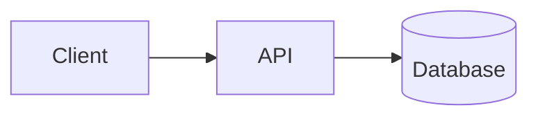

# md2star : exemples et aide-mémoire de syntaxe ⭐️

🇫🇷 Français · [🇬🇧 EXAMPLES.md](https://github.com/warith-harchaoui/md2star/blob/main/EXAMPLES.md)

Bienvenue dans l'aide-mémoire de syntaxe de `md2star` ! Parce que `md2star` étend Pandoc pur en corrigeant des défauts de mise en page agaçants (en particulier autour des listes à puces et des blocs `mermaid`), vous pouvez mettre en forme vos documents dynamiquement sans casser vos flux de travail.

Les extraits des sections 1 à 11 ont été exécutés le 27/10/2026 avec **md2star
3.10.0 et Pandoc 3.6.1**, hors ligne, puis chaque sortie citée ci-dessous est
celle qui est revenue. La section 12 fait exception — elle réclame le modèle
d'un designer ainsi qu'un LLM puis un VLM locaux — ce qu'elle annonce dès son
début, au lieu de déguiser une exécution non mesurée en transcription.

Les sources des exemples vivent dans
[`tests/examples/`](https://github.com/warith-harchaoui/md2star/tree/main/tests/examples).
Les `.docx` / `.pptx` rendus ne sont **pas** dans le dépôt — ce sont des
artefacts de compilation que `.gitignore` écarte — donc générez-les vous-même :

```bash
cd tests/examples && ./run.sh      # DOCX + PPTX pour chaque source ci-dessous
```

| Source | Ce qu'elle démontre |
|---|---|
| `comprehensive_document.md` | toute la surface de syntaxe en un document |
| `comprehensive_presentation.md` | la même chose en diapositives, avec un partage `::: columns` |
| `guide_complet_document_fr.md` | un document français : langue détectée, date localisée |
| `branded_slides.md` + `Presentation1.pptx` | un `.pptx` maison servant de modèle de référence |
| `footnotes_document.md` | les notes de bas de page, en DOCX puis en PPTX |
| `table_zoo.md` | tableaux larges et déséquilibrés (hors `run.sh` : `md2docx table_zoo.md`) |

## Table des matières

- [Mise en place](#mise-en-place)
- [1. Titre et sous-titres](#1-titre-et-sous-titres)
- [2. Diagrammes Mermaid](#2-diagrammes-mermaid)
- [3. Des listes toujours bien formées](#3-des-listes-toujours-bien-formées)
- [4. Diapositives à plusieurs colonnes (PPTX uniquement)](#4-diapositives-à-plusieurs-colonnes-pptx-uniquement)
- [5. Mathématiques LaTeX](#5-mathématiques-latex)
- [6. Bibliographies pour documents d'entreprise](#6-bibliographies-pour-documents-dentreprise)
- [7. Modèles de marque (PPTX)](#7-modèles-de-marque-pptx)
- [8. Détection de langue et localisation des dates](#8-détection-de-langue-et-localisation-des-dates)
- [9. Sauts de page (DOCX uniquement)](#9-sauts-de-page-docx-uniquement)
- [10. Notes de bas de page](#10-notes-de-bas-de-page)
- [11. Le sens inverse : le jumeau Markdown](#11-le-sens-inverse--le-jumeau-markdown)
- [12. PPTX intelligent vis-à-vis du modèle](#12-pptx-intelligent-vis-à-vis-du-modèle)
- [Ligne de commande](#ligne-de-commande)
- [Dépannage](#dépannage)

## Mise en place

```bash
pipx install md2star        # les quatre CLI + la GUI, dans leur propre venv
brew install pandoc         # la seule dépendance dure (apt : pandoc, winget : JohnMacFarlane.Pandoc)
md2star doctor              # ce qui est installé, ce qui manque, ce qui marche quand même
```

`md2star doctor` est la commande à lancer avant toute autre : elle affiche les
versions de Python, de md2star puis de Pandoc, ainsi que chaque dépendance
optionnelle avec la raison de la vouloir. Trois fonctionnalités réclament une
chose de plus sur le PATH — la sortie PDF veut LibreOffice (`soffice`), Mermaid
veut Node.js
puis les passes IA optionnelles (`--lint`, `twin --diagrams`, `--smart-layout`)
veulent un exécuteur de modèle local. Deux commandes vivent derrière des
extras : `pip install 'md2star[pptx]'` pour `md2star audit` et `md2pptx
--smart-layout`, `pip install 'md2star[ocr]'` pour `md2star twin`.

Chaque extrait shell ci-dessous suppose un fichier Markdown dans le dossier
courant, rien d'autre. `--offline` apparaît partout où l'exécution aurait
sinon le droit d'aller chercher le modèle par défaut sur `deraison.ai` ;
retirez-le quand vous voulez ce modèle.

Les extraits Python supposent ces imports :

```python
from pathlib import Path

from md2star import preprocess_markdown  # la passe de correction du Markdown, seule
from md2star.pipeline import ConvertOptions, convert  # toute la conversion, en un appel
from md2star.pptx_audit import audit, summarise  # l'auditeur de diaporama (extra [pptx])
```

`convert` est le point d'entrée public : la CLI, le serveur GUI puis l'API HTTP
atteignent tous le moteur par lui, avec la même dataclass gelée
`ConvertOptions`. Chaque champ porte la valeur par défaut annoncée par la CLI,
si bien qu'un appel court est un appel complet :

```python
rc = convert(
    "docx",
    ConvertOptions(input="doc.md", output="api-out.docx", offline=True, author="Ada Lovelace"),
)
print("rc =", rc)
```

```text
Wrote: …/api-out.docx
rc = 0
```

Un retour non nul est le code de sortie de Pandoc lui-même (ou de LibreOffice,
pour `pdf`), rendu au lieu d'être avalé.

---

## 1. Titre et sous-titres

`md2star` extrait automatiquement le premier `# Titre` et l'utilise comme métadonnée **Titre** du document. Avec `--author`, la chaîne d'auteur, accolée à la date localisée, construit le **Sous-titre**.

```bash
md2docx doc.md --author "Someone Great" --offline
```

Lancée sur un document anglais d'un paragraphe intitulé `# Quarterly report`,
la commande place exactement trois chaînes en tête du DOCX : le titre, l'auteur
puis la date.

```text
['Quarterly report', 'Someone Great', 'Tuesday, October 27, 2026']
```

La date suit la langue **détectée** ; le filtre Lua met volontairement sa
première lettre en capitale, pour qu'un jour de la semaine français ou russe se
lise comme un titre plutôt que comme de la prose. Le même document d'un
paragraphe, en quatre langues, converti le 27/10/2026 :

| Langue détectée | Date du sous-titre |
|---|---|
| anglais (`en-US`) | `Tuesday, October 27, 2026` |
| français (`fr-FR`) | `Mardi 27 octobre 2026` |
| espagnol (`es-ES`) | `Martes, 27 de octubre de 2026` |
| allemand (`de-DE`) | `Dienstag, 27. Oktober 2026` |

Passez `--date` pour tout remplacer par une chaîne reprise telle quelle
(`--date '2026-T2'`).

---

## 2. Diagrammes Mermaid

Pandoc standard échoue sur les blocs de code balisés ````mermaid`. `md2star` les convertit automatiquement en PNG haute résolution grâce au CLI Mermaid, exécuté localement : aucune donnée ne quitte votre machine.

```markdown
Voici l'architecture de notre pipeline :

` ` `mermaid
graph LR;
    Raw[Markdown Source] --> Engine[md2star Preprocessor]
    Engine --> Office[DOCX/PPTX]
` ` `
```

Converti avec `md2docx mer.md --offline`, ce graphe de trois nœuds prend une
petite seconde de plus que le reste de la conversion puis arrive dans le DOCX
comme une vraie partie image :

```text
['word/media/rId20.png']
```

> [!TIP]
> Le rendu Mermaid nécessite Node.js (≥16) sur votre PATH. `md2star` appelle
> `npx -y @mermaid-js/mermaid-cli` : le CLI est donc récupéré une fois au
> premier usage (seule étape réseau) puis un `mmdc` global est réutilisé quand
> vous en avez un. Le rendu lui-même est local : la source du diagramme ne
> quitte jamais la machine.

---

## 3. Des listes toujours bien formées

On colle souvent une liste à puces directement à un paragraphe, sans ligne vide : Pandoc, alors, force un rendu en bloc en ligne et casse la sortie. Le moteur AST Python de `md2star` insère l'espacement correct pour que les listes à puces s'affichent toujours proprement.

```markdown
# Offre

Notre entreprise propose :
- Un habillage DOCX sans accroc
- Une structuration fine des grilles PPTX
- Des évaluations mathématiques
```

On peut observer la correction sans rien convertir, car le préprocesseur est
une simple fonction :

```python
print(preprocess_markdown(Path("liste.md").read_text(), base_dir="."))
```

```text
---
lang: fr-FR
date_format: "%A %e %B %Y"
---

# Offre

Notre entreprise propose :

- Un habillage DOCX sans accroc

- Une structuration fine des grilles PPTX

- Des évaluations mathématiques
```

Deux choses se sont produites : la ligne vide dont Pandoc a besoin avant la
liste a été insérée puis la langue détectée a été injectée en en-tête YAML
(voir la section 8). Le DOCX obtenu porte trois vrais éléments de liste — trois
propriétés de numérotation `w:numPr` — au lieu d'un paragraphe collé.

---

## 4. Diapositives à plusieurs colonnes (PPTX uniquement)

Coupez une diapositive en deux moitiés avec la syntaxe de **div balisés** de
Pandoc : un div `columns` qui contient un div `column` par moitié.

```markdown
## Two halves

::: columns
:::: column
This is my left paragraph.
::::

:::: column
This is my right paragraph.
::::
:::
```

`md2pptx cols.md --offline` place les deux moitiés sur une seule diapositive,
sur la disposition `Two Content` de Pandoc, avec le titre en en-tête :

```text
ppt/slides/slide3.xml  slideLayout4.xml (Two Content)
  ['Two halves', 'This is my left paragraph.', 'This is my right paragraph.']
```

Deux détails mesurés méritent d'être retenus :

- Le div doit être le contenu de la diapositive, **directement** après le
  titre. Un paragraphe inséré entre les deux pousse les colonnes sur une
  diapositive à part : Pandoc ouvre une nouvelle diapositive au div plutôt que
  de mélanger les deux formes.
- Une ligne `{.column}` seule n'est **pas** une syntaxe de colonnes. Pandoc n'a
  pas ce span : il traverse donc en texte littéral puis PowerPoint affiche
  `{.column}` au milieu de la diapositive. Le fichier
  `tests/examples/comprehensive_presentation.md` portait cette forme ; il porte
  désormais celle ci-dessus.

---

## 5. Mathématiques LaTeX

Utilisez des expressions LaTeX natives entre balises `$$`. Pandoc les compile en objets Équation mathématique natifs de Word ou PowerPoint.

```markdown
Nous évaluons l'équation structurelle classique :

$$
e^{i \times \pi}+1 = 0
$$
```

Le DOCX obtenu porte l'équation comme objet équation natif de Word (un nœud
`m:oMath` dans un `m:oMathPara`) et ne contient **aucun** élément `w:drawing` :
rien n'a été discrètement rastérisé en image, la formule reste donc éditable
dans l'éditeur d'équations de Word.

---

## 6. Bibliographies pour documents d'entreprise

Pour les documents techniques volumineux, `md2star` s'appuie sur des bibliothèques `.bib` natives via `--bib` :

```markdown
Standard AI scaling laws have been deeply structured inside causality research metrics [@causality-pearl].
```

**Compilation :**
```bash
md2pptx presentation.md --bib references.bib --bibliography-name "References"
```

L'option `--bibliography-name` insère en fin de document un titre, suivi de la
liste des citations compilées. Omettez-la et md2star reprend le titre localisé
par défaut pour la langue du document (`Références` en français, etc.) : voilà pourquoi la valeur par défaut de l'option est `None` plutôt que
`« Bibliographie »`.

Lancé contre l'`assets/references.bib` de ce dépôt, le texte du DOCX revient
ainsi :

```text
['Scaling laws', 'Tuesday, October 27, 2026',
 'Standard AI scaling laws have been deeply structured inside causality',
 'research metrics', '(Pearl 2009)', '.',
 'References',
 'Pearl, Judea. 2009.', 'Causality: Models, Reasoning, and Inference, 2nd Edition',
 '.', 'https://bayes.cs.ucla.edu/BOOK-2K/', '.']
```

La clé `[@causality-pearl]` est devenue `(Pearl 2009)` dans la prose puis
l'entrée a été mise en forme dans la section `References` ajoutée. Un chemin
`.bib` inexistant est refusé par la CLI avant même l'appel à Pandoc, car une
faute de frappe surgirait sinon sous forme d'erreur citeproc à plusieurs écrans
de là.

---

## 7. Modèles de marque (PPTX)

Utilisez n'importe quel `.pptx` comme modèle de référence pour habiller vos diapositives à votre marque. Si le modèle porte déjà les noms de mise en page standard de Pandoc (`Title Slide`, `Title and Content`, etc.), employez-le directement :

```bash
md2pptx slides.md --reference-doc Presentation1.pptx
```

Mesuré sur le `tests/examples/branded_slides.md` de ce dépôt avec son
`Presentation1.pptx` : six diapositives, bâties sur le masque **du modèle** et
non sur celui de Pandoc, avec le texte du Markdown dans les emplacements du
modèle.

Pour les modèles d'entreprise aux noms de mise en page non standard, utilisez
l'outil compagnon [md2star-adapt](https://github.com/warith-harchaoui/md2star-adapt)
pour construire un document de référence compatible, puis pointez `md2pptx`
vers lui avec `--reference-doc branded_ref.pptx`.

---

## 8. Détection de langue et localisation des dates

`md2star` détecte automatiquement la langue de votre contenu et localise les dates en conséquence, sans configuration. Langues prises en charge : français, espagnol, allemand, italien, portugais, néerlandais, russe, chinois et japonais.

```markdown
# Test du langage

J'ai un « je ne sais quoi » que je ne connais pas.
```

```bash
md2docx document.md --author "Utilisateur"
# → Sous-titre : « Utilisateur, dimanche 10 mai 2026 »
```

Vous pouvez forcer une valeur via des métadonnées explicites :
```yaml
---
lang: fr-FR
date_format: "%A %e %B %Y"
---
```

---

## 9. Sauts de page (DOCX uniquement)

Un filet horizontal (`---` seul sur sa ligne) se transforme en un vrai saut
de page dans la sortie DOCX. Le filtre Lua ne déclenche cette transformation
que pour l'écrivain DOCX : PPTX conserve le rendu par défaut du filet
horizontal, car la structure des diapositives en PPTX vient déjà des titres
`## ` ; y superposer `---` entrerait en conflit avec cette intention.

```markdown
# Page 1

The opening paragraph stays on page 1.

---

# Page 2

After the `---`, Word starts a brand-new page automatically.

---

## Even a subsection works

The page break fires for any standalone `---`, not only between
`# Heading 1` blocks.
```

**Compilation :**
```bash
md2docx pagebreaks.md
```

Mesuré sur le document de deux pages ci-dessus, `word/document.xml` revient
avec exactement un `<w:br w:type="page"/>` : un `---` écrit, un saut de page
dur, aucun saut parasite.

> [!TIP]
> Le `---` doit être seul sur sa **propre ligne**, entouré de lignes vides
> au-dessus et en dessous : c'est la syntaxe standard du filet horizontal
> Pandoc. Un `---` à l'intérieur d'un bloc de métadonnées YAML (l'en-tête du
> document) n'est pas concerné : Pandoc le consomme comme délimiteur de
> métadonnées avant même que le filtre Lua ne l'atteigne.

> [!NOTE]
> Aucun équivalent en PPTX. Pour forcer un changement de diapositive,
> commencez un nouveau `## Titre` : c'est ainsi que Pandoc fait correspondre
> le Markdown aux diapositives PowerPoint.

---

## 10. Notes de bas de page

Les notes de bas de page Markdown passent directement en **notes natives
Word** : elles atterrissent dans la partie `word/footnotes.xml` du DOCX, si
bien que Word les affiche en bas de page avec des appels de note cliquables
et une renumérotation automatique. `md2star` n'applique aucun prétraitement
particulier ici ; le lecteur Markdown par défaut de Pandoc a l'extension
`footnotes` activée, si bien que la syntaxe standard `[^label]` fonctionne
telle quelle.

```markdown
Structured evaluation shows a 12% gain.[^bench] The gain holds even
under adversarial inputs.[^adv]

[^bench]: Measured on the internal benchmark suite, 2026-Q2 run.
[^adv]: See the red-team appendix for the full protocol.
```

Les labels sont des identifiants arbitraires (`[^1]`, `[^bench]`,
`[^note-a]`) : Word réordonne et renumérote automatiquement les appels
visibles, si bien que le label choisi ne transparaît jamais dans le
résultat. Vous pouvez aussi insérer la note directement en ligne avec la
forme `^[...]` :

```markdown
The result reproduces across seeds.^[Ten seeds, variance under 1%.]
```

**Compilation :**
```bash
md2docx report.md
```

Le DOCX porte bien une partie `word/footnotes.xml` et les trois notes y
atterrissent, y compris celle en ligne `^[…]` :

```text
has word/footnotes.xml: True
['Measured on the internal benchmark suite, 2026-Q2 run.',
 'See the red-team appendix for the full protocol.',
 'Ten seeds, variance under 1%.']
```

> [!TIP]
> Les notes fonctionnent aussi bien en DOCX qu'en PPTX, mais elles n'atterrissent
> pas au même endroit. Le DOCX obtient de vraies notes en bas de page. Le PPTX
> n'a pas cette notion : Pandoc regroupe donc **toutes les notes du diaporama
> sur une dernière diapositive intitulée « Notes »**, numérotées à l'échelle de
> la présentation entière — ni par diapositive, ni dans le panneau de
> l'orateur. Un diaporama de deux diapositives portant une note chacune rend
> donc trois diapositives, la dernière affichant `1. …` puis `2. …`. Pour un
> script d'orateur par diapositive, utilisez plutôt un bloc `::: notes`
> (section 12).

## 11. Le sens inverse : le jumeau Markdown

Allez dans l'*autre* sens : transformez un document fini en source Markdown
éditable. `md2star twin` récupère la prose et les tableaux GFM, extrait
chaque image intégrée vers un dossier `assets/` et rétablit les liens : le
résultat est une vraie source, éditable et re-rendable, pas un simple
export texte à plat. Fonctionne sur **tout PDF ou tout format que
LibreOffice sait convertir en PDF** (`.docx`, `.pptx`, `.odt`, `.rtf`,
`.html`, …).
Nécessite l'extra `[ocr]` : `pip install 'md2star[ocr]'`.

```bash
# report.pdf  →  report.md + assets/img-p1-0.png …
md2star twin report.pdf --out ./recovered/

# prose + tableaux seulement, sans images extraites
md2star twin report.pdf --no-images
```

Ajoutez `--diagrams` (option, nécessite l'extra `[ocr]` et un Ollama local) :
`md2star` classe alors chaque image extraite avec un modèle de vision local
dans l'une de trois catégories : les **photos restent en PNG**, les
**diagrammes de nœuds et d'arêtes sont réécrits en Mermaid** ; les autres
**figures vectorielles** (graphiques, tracés, logos, icônes, dessins au
trait) sont réécrites en **SVG** éditable, écrit à côté du raster. Chaque
candidat, Mermaid ou SVG, est vérifié par la même *boucle d'appariement
visuel* : on le rend (le même `mmdc` que le chemin direct utilise pour
Mermaid ; un rastériseur détecté, `cairosvg`, `rsvg-convert`, `inkscape` ou
ImageMagick, pour le SVG), on le compare à l'image extraite d'origine avec
le VLM ; on itère jusqu'à ce qu'il corresponde. Le PNG d'origine reste
toujours conservé en commentaire de repli, si bien qu'une reconstruction
n'est jamais une impasse avec perte.

```bash
# les diagrammes deviennent du Mermaid éditable ; les photos restent en PNG
md2star twin architecture.pdf --diagrams --out ./recovered/
```

Un diagramme récupéré atterrit dans le jumeau ainsi : du code éditable,
avec le raster source conservé en dessous :

````markdown


<!-- source figure:  -->
````

> [!TIP]
> Le jumeau est l'inverse de la sortie propre de `md2star` : on rend
> d'abord le Markdown en DOCX/PDF avec les CLI directs, puis `md2star twin`
> relit le résultat. Comme un diagramme reconstruit est du Mermaid (que le
> chemin direct rend nativement), l'aller-retour `md → doc → twin → doc`
> garde les diagrammes sous forme de code de bout en bout.

### Le jumeau dans le GUI et sur HTTP

Le jumeau n'est pas réservé au CLI. Dans l'éditeur complet (`md2star gui`),
le contrôle **Import** offre deux bascules :

- **Jumeau (Twin)** : conserve les images extraites. Le `<stem>.md`
  récupéré **et** un dossier `assets/` sont écrits dans le dossier ouvert
  (pour que les liens d'image se résolvent au re-rendu) ; la barre
  latérale se rafraîchit. Nécessite un dossier ouvert ; l'**Import** simple
  reste un chargement texte seul.
- **Mermaid** : réécrit en plus les figures de nœuds et d'arêtes via le VLM
  local (nécessite la pile `[ocr]` et Ollama). Implique **Jumeau**.

Sur l'API HTTP (`md2star-api`), `POST /extract` prend les mêmes options en
champs de formulaire : texte seul renvoie du JSON, jumeau renvoie un zip
contenant `<stem>.md` + `assets/` :

```bash
# Texte seul (JSON : {"filename": "report.md", "markdown": "..."})
curl -sF file=@report.pdf http://localhost:8000/extract

# Jumeau complet (un report.zip contenant report.md + assets/)
curl -sF file=@report.pdf -F twin=true \
     -o report.zip http://localhost:8000/extract

# Jumeau + reconstruction IA des diagrammes (implique le jumeau ; nécessite la pile [ocr])
curl -sF file=@architecture.pdf -F diagrams=true \
     -o architecture.zip http://localhost:8000/extract
```

## 12. PPTX intelligent vis-à-vis du modèle

Le writer PPTX de Pandoc n'atteint jamais que les ~7 dispositions
génériques de son modèle embarqué.
`md2pptx --smart-layout --template <modele-designer.pptx>` place au
contraire chaque diapositive Markdown dans le **vocabulaire de
dispositions du vrai modèle du designer** : un LLM lit le contenu de
chaque diapositive face à un catalogue des dispositions nommées du
modèle et choisit la mieux adaptée, un **VLM confirme ou corrige
visuellement** ce choix face aux vignettes réelles des dispositions
candidates (et non seulement à leurs légendes), puis un assembleur
`python-pptx` construit le deck directement sur la disposition retenue,
diapositive par diapositive. Nécessite l'extra `[pptx]`
(`pip install 'md2star[pptx]'`) et un moteur LLM+VLM local résolu (la
même pile `best_engine_ai_helper` que `--lint` / `twin --diagrams`).

> [!NOTE]
> C'est la seule section qui n'a **pas** été remesurée pour ce fichier : le
> chemin réclame le `.pptx` d'un designer ainsi qu'un LLM+VLM résolu. Les
> transcriptions ci-dessous sont les formes que md2star affiche — chacune
> vérifiée face aux chaînes de format de `md2star/pipeline.py`,
> `md2star/pptx_assemble.py` puis `md2star/pptx_audit.py` — avec des numéros de
> diapositive et des noms de disposition donnés à titre d'illustration, pas une
> exécution capturée. L'audit en fin de section, lui, a bien été mesuré : il ne
> réclame aucun modèle.

```bash
md2pptx presentation.md --template ./marque/Modele-Entreprise.pptx --smart-layout
```

Ajoutez `--eyeball-iterations N` (0 par défaut, désactivé) pour exécuter
une **boucle Ralph Eyeball par appariement de cible** après l'assemblage :
chaque passe rend le deck, montre au modèle de vision à la fois une
diapositive candidate et la vignette de la disposition choisie et
applique des corrections bornées (réduire un titre qui débordait, limiter
le nombre de puces, agrandir une image trop petite) — sans jamais toucher
à l'image, seulement à la spécification que l'assembleur relit.

```bash
md2pptx presentation.md --template ./marque/Modele-Entreprise.pptx \
    --smart-layout --eyeball-iterations 2
```

> [!TIP]
> `--no-visual-confirm` saute l'étape d'arbitrage VLM (sélection
> textuelle seule, moins coûteuse) quand le premier choix du LLM doit
> être considéré comme définitif.

### Les diapositives du designer, pas seulement ses dispositions

Une disposition porte le fond et les boîtes de contenu. Les filets
d'accent, les chevrons numérotés, les traits décoratifs — les formes sur
mesure qui font qu'un deck *se ressemble* — vivent un cran plus loin, sur
les **diapositives d'exemple** du modèle. `--reference-slides` clone la
page d'exemple de la disposition retenue et en remplace le contenu par le
vôtre :

```bash
md2pptx presentation.md --template ./marque/Modele-Entreprise.pptx \
    --smart-layout --reference-slides
```

```text
Wrote: presentation.pptx (14/14 slides, 11 from the template's own pages)
```

Votre titre va dans leur titre, vos puces dans leurs colonnes — en
gardant leur glyphe de puce, leur graisse, leur corps et leur couleur — et
votre image dans leur emplacement photo, ajustée sans jamais être étirée.
Tout ce qu'ils ont dessiné autour reste exactement où ils l'ont dessiné.

Rien de ce qu'ils ont **écrit** ne suit. Chaque cadre de texte d'une page
clonée est soit rempli avec votre contenu, soit retiré — et le retrait
distingue le texte bouche-trou du dessin : l'ornement reste (le « 01 »
d'une étape numérotée **est** le dessin), une simple zone de texte part,
et une forme automatique est vidée mais conservée, parce qu'un chevron est
un objet dessiné. Leur photo d'illustration est retirée du fichier
lui-même et pas seulement de la diapositive ; leurs liens hypertextes ne
survivent pas aux mots auxquels ils étaient attachés.

Une page qui ne peut pas porter honnêtement une diapositive est
**refusée, pas remplie à moitié** : une composition à trois colonnes exige
au moins trois puces ; une diapositive avec image exige un emplacement
photo et une page composée autour d'une photographie exige une image (leur
photo d'illustration doit partir, or le reste de la page a été composé
autour de sa forme) ; enfin une page portant un graphique ou un tableau est
refusée d'office, aucun remplacement ne pouvant reformuler les chiffres de
quelqu'un d'autre. Une page est également refusée quand votre texte devrait
**descendre sous 12 pt** pour tenir dans les cadres que le designer a
dimensionnés pour sa propre ligne : la question posée n'est pas « est-ce
que ça déborde ? » mais « jusqu'où faudrait-il rétrécir ? », puisqu'un
moteur de rendu répond au débordement en rapetissant le corps sans rien
dire. Parmi les pages qui conviennent, une diapositive avec
image prend celle dont l'emplacement est le **plus grand** — l'ajustement
par contenance fait que cet emplacement est exactement la taille que le
lecteur verra. Les diapositives refusées repassent par l'assembleur
habituel : l'option ne fait donc qu'ajouter — et un modèle distribué sans
aucune page d'exemple se construit exactement comme sans elle.

La boucle Ralph Eyeball a **deux yeux** et un seul a besoin d'un modèle.
Chaque passe exécute l'audit déterministe de md2star sur le fichier qui
vient d'être écrit — du texte qui réclame plus de place que sa boîte, une
forme hors du cadre, un corps sous 12 pt — et renvoie chaque constat sous
forme de verdict. En cas de désaccord, **la mesure l'emporte** : un modèle
de vision qui regarde un rendu ne peut pas voir un débordement, puisque
PowerPoint l'a déjà masqué en rapetissant le corps. `--eyeball-iterations
N` fait donc un vrai travail sur une machine sans modèle de vision, sans
LibreOffice et sans réseau.

Étant une mesure, cet œil connaît aussi la réponse et pas seulement le
grief. Un débordement est signalé avec la taille qui, elle, tiendrait : la
boucle applique donc la correction exacte d'un coup au lieu de tâtonner
vers elle — et quand cette taille passe elle-même sous 12 pt, elle cesse de
proposer de rétrécir : aucun corps ne gagne cette diapositive, elle part
donc chercher une boîte réellement assez grande (une autre page du
designer, puis une autre mise en page).

Ajoutez `--eyeball-iterations N` et la boucle gagne deux choses de plus
qu'elle n'a sur aucun autre chemin. Sa **cible** devient la page du
designer dont chaque diapositive a été clonée — la candidate est
littéralement cette page avec vos mots dedans, donc tout écart vu par le
modèle de vision parle de *cette* diapositive, pas de la famille de mises
en page. Et elle gagne un **correctif qu'elle n'avait pas** : quand une
diapositive est signalée sans correction bornée applicable (`too_empty` et
un défaut d'alignement n'en ont jamais eu), la boucle la déplace sur **une
autre démonstration de la même mise en page par le designer** avant
d'envisager un changement de mise en page.

```bash
md2pptx presentation.md --template ./marque/Modele-Entreprise.pptx \
    --smart-layout --reference-slides --eyeball-iterations 2
```

```text
eyeball loop: slide 4 — example page 31 is not carrying it (a void on the
  right half); trying another page of Split1_lime
```

Un designer qui a démontré une mise en page de cinq façons vous a donné
cinq compositions : aller en chercher une autre de *lui* est une correction
plus petite et plus fidèle que d'abandonner la mise en page qu'il a
choisie. Ce n'est qu'une fois toutes les pages jugées puis refusées que la
diapositive retombe — d'abord sur une autre mise en page, enfin sur
l'assembleur nu, qui sait toujours la placer.

### Notes de l'orateur

Un bloc Pandoc `::: notes` est le script de l'orateur et il part dans le
volet des notes sur les deux chemins — le chemin Pandoc ordinaire comme
`--smart-layout` :

```markdown
## Chiffre d'affaires T3

- +18 % sur un an

::: notes
Les 18 % restent provisoires jusqu'à la clôture de l'audit. Ne pas
prendre de questions sur le segment européen.
:::
```

### L'audit de disposition

Chaque exécution `--smart-layout` se termine par un audit déterministe du
deck qui vient d'être écrit — sans modèle, sans rendu, sans réseau, donc
il rapporte la même chose sur une machine sans aucun LLM :

```text
Wrote: presentation.pptx (14/14 slides)
layout audit: 2 findings on 2 slides (1 overlap, 1 overrun)
```

C'est aussi un outil à part entière, pointé sur **n'importe quelle**
présentation — celle qu'un collègue vous a envoyée, une faite sous
PowerPoint, une que vous aviez montée il y a des années :

```bash
md2star audit lasienne.pptx            # lisible, un constat par ligne
md2star audit lasienne.pptx --json     # les mêmes constats, exploitables
md2star audit lasienne.pptx --strict   # échoue aussi sur `overrun`
```

Le code de sortie vaut `1` en présence d'un **défaut** (hors cadre,
chevauchement, emplacement fantôme, corps illisible) et `0` s'il ne reste que
des observations : il s'insère donc tel quel dans un job CI ou un hook
pre-commit. La présentation est lue, jamais écrite.

Avec `-v`, chaque constat apparaît avec sa mesure :

```text
slide 7: overlap — 'Title 1' and 'TextBox 4' share 38% of the smaller box
slide 9: overrun [TextBox 3] — text needs 1.6x its box at 16pt (fits at ~13pt)
```

Les six vérifications sont `off-slide` (hors diapositive), `overlap`
(texte sur texte — du texte sur une *image* est une composition, pas un
défaut), `ghost-placeholder` (emplacement fantôme), `illegible-type`
(sous 12 pt), `low-contrast` (contraste insuffisant) et `overrun`
(débordement). `low-contrast` applique le rapport WCAG, avec
linéarisation sRGB, contre le plancher de 3:1 que mérite un grand corps et
celui de 4,5:1 qu'un petit n'obtient pas — le fond étant résolu comme le
résout un moteur de rendu (les formes sous le texte, puis le fond de la
diapositive, puis les formes et le fond de la mise en page, puis ceux du
masque), parce que le panneau coloré sur lequel un titre est posé est
d'ordinaire une forme de la *mise en page* alors que le fond de celle-ci
est l'autre moitié de la diapositive. Du texte sur une photographie ou
une graphie qui hérite sa couleur du thème, est laissé sans jugement
plutôt que deviné. Un `overrun` est une observation
plutôt qu'une erreur : PowerPoint réduit le texte automatiquement, la
conséquence est donc silencieuse et le constat vous dit quelle est la
vraie taille de la diapositive. Disponible aussi comme appel de
bibliothèque :

```python
findings = audit(Path("presentation.pptx"))
print(summarise(findings, slides=5))
for finding in findings:
    print(finding)
```

Pointé sur un diaporama de cinq diapositives que md2star venait de produire par
le chemin Pandoc ordinaire, il a trouvé quelque chose de réel :

```text
layout audit: 1 finding on 1 slide (1 ghost-placeholder)
slide 1: ghost-placeholder [Subtitle 2] — unfilled placeholder
```

La CLI affiche les deux mêmes lignes puis sort en `1`, car un emplacement
fantôme est un défaut et non une observation. `audit` réclame l'extra
`[pptx]` ; il ne réclame rien d'autre : ni modèle, ni rendu, ni réseau.

`--smart-layout` contourne entièrement Pandoc pour cette exécution —
`--template` y joue le rôle que tient normalement un reference-doc
Pandoc. Le chemin ordinaire `md2pptx presentation.md` (sans
`--smart-layout`) n'est pas affecté et reste le comportement par défaut.
Voir `docs/design/pptx-template-intelligence.md` pour la conception
complète (format du catalogue, prompts de sélection de disposition, forme
de la boucle eyeball).

## Ligne de commande

md2star n'a qu'**une** ligne de commande, bâtie avec click. `md2docx`,
`md2pptx` puis `md2pdf` sont des raccourcis, pas des alias : ils se résolvent
vers les mêmes objets de commande que `md2star docx|pptx|pdf`, si bien qu'une
option ne peut pas exister sur une écriture et manquer sur l'autre.

```text
Usage: md2star [OPTIONS] COMMAND [ARGS]...

  Markdown → DOCX / PPTX / PDF, and back again.

  A Pandoc wrapper with curated templates, BibTeX citations, Mermaid
  rendering, math and remote-image embedding — plus "twin", which reads a
  finished document back into editable Markdown, and "audit", which measures a
  deck for overlapping or unreadable text.

  md2docx, md2pptx and md2pdf are installed as shorthands for the three
  conversions; they are the same commands, with the same flags.

Options:
  -V, --version  Show the version and exit.
  -h, --help     Show this message and exit.

Commands:
  docx         Markdown → Microsoft Word (.docx).
  pptx         Markdown → Microsoft PowerPoint (.pptx).
  pdf          Markdown → Portable Document Format (.pdf, via headless
               LibreOffice).
  gui          Launch the local Markdown editor with a live PDF preview.
  twin         Read a document back into an editable Markdown twin (prose...
  audit        Report overlaps, off-canvas shapes and unreadable type in...
  doctor       Print a diagnostic summary of the environment md2star runs...
  templates    Inspect bundled / cached / per-project templates without...
  cache-dir    Print the resolved cache directory path.
  clear-cache  Wipe the cache directory (templates, resized rasters,...
```

Tout ce que md2star ne reconnaît pas est transmis à Pandoc **tel quel et en
dernier**, si bien que les options propres à Pandoc continuent de fonctionner
puis l'emportent en cas de désaccord :

```bash
md2docx report.md --toc --number-sections    # --toc et --number-sections sont à Pandoc
md2pptx report.md --offline --slide-level=2  # --slide-level aussi
```

Les deux ont bien atteint Pandoc : le DOCX est revenu avec un vrai champ `TOC`
de Word puis des titres numérotés —

```text
['Report', 'Table of Contents', 'Tuesday, October 27, 2026',
 '1', 'Section one', 'Text.', '2', 'Section two']
```

L'aller-retour complet, en quatre commandes et sans réseau :

```bash
md2docx doc.md --author "Ada Lovelace" --offline   # Markdown → DOCX
md2pdf  doc.md --offline                           # Markdown → PDF (LibreOffice)
md2star twin doc.pdf --no-images --out ./recovered/
cat recovered/doc.md
```

```text
Wrote: …/doc.docx
Wrote: …/doc.pdf
md2star: reading doc.pdf back to a Markdown twin via Kreuzberg
md2star: wrote twin doc.md (0 image(s))
recovered/doc.md
# Quarterly report

## Tuesday, October 27, 2026

The opening paragraph.
```

Le titre est revenu en titre, le sous-titre généré en sous-titre, la prose en
prose : une source éditable et re-rendable, pas un vidage de texte.

## Dépannage

Quatre échecs expliquent presque tous les mauvais premiers essais. Chaque
message ci-dessous est celui que md2star affiche réellement, ici avec
`MD2STAR_LANG=fr` : la CLI traduit ses diagnostics, même si quelques lignes
d'indice attendent encore leur traduction.

**Pandoc n'est pas installé.** La seule dépendance dure, celle que l'erreur
nomme immédiatement :

```text
md2star: pandoc est introuvable dans le PATH
  Install it from https://pandoc.org/installing.html (macOS: `brew install pandoc`,
  Ubuntu: `sudo apt install pandoc`, Windows: `winget install --id JohnMacFarlane.Pandoc`).
  Then re-run; `md2star doctor` confirms the install.
```

**La sortie est aussi l'entrée.** `md2docx doc.md -o doc.md` écrirait un DOCX
par-dessus sa propre source : c'est donc refusé.

```text
md2star: md2docx : …/doc.md est à la fois l'entrée et la sortie
  Écrire le fichier converti par-dessus sa propre source détruirait le document.
  Donnez un --output différent, ou retirez --output pour écrire à côté de la
  source avec la bonne extension.
```

**Une option réclame sa compagne.** `--smart-layout` n'a pas de sens sans le
modèle du designer : il le dit au lieu de se rabattre en silence.

```text
md2star: md2pptx --smart-layout : --template <gabarit.pptx> est obligatoire
  Faites pointer --template vers le PPTX du graphiste, pas vers le gabarit livré
  avec md2star.
```

**Une commande est derrière un extra.** `md2star audit` puis `md2pptx
--smart-layout` réclament `pip install 'md2star[pptx]'` ; `md2star twin`
réclame `pip install 'md2star[ocr]'`. `md2star doctor` les signale en
`MISSING` avec la ligne d'installation, puis sort quand même en `0` : un extra
optionnel manquant n'est pas une installation cassée.

Deux autres points utiles : `md2pdf` réclame LibreOffice (`soffice`), car le
PDF est rendu depuis le DOCX, puis une image `` est laissée en
place avec un avertissement tant que vous ne passez pas
`--allow-remote-images`. `--offline` interdit d'un coup toute phase touchant au
réseau, y compris la récupération du modèle par défaut : c'est le plus court
chemin vers une exécution reproductible.
